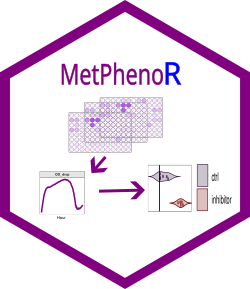

# MetPhenoR
[](https://cran.r-project.org/web/licenses/GPL)
[](https://cran.r-project.org/package=MetPhenoR)

<p align="center">
  
</p>


The **complete workflow** including examples can be found in vignettes/MetPhenoR.html.
A flowchart of the package can be found in man/figures/MetPhenoR_workflow_flowchart.png

## Installation 
MetPhenoR is available on CRAN:

```r
install.packages("MetPhenoR")
```

## Installation from GitHub

Install the latest version directly from GitHub `remotes` package:

```r
# Install remotes if you haven't already
if (!require("remotes", quietly = TRUE)) {
  install.packages("remotes")
}

# Install MetPhenoR from GitHub
remotes::install_github(KatjaDanielzik/MetPhenoR)
```

## Data Preparation

Before analyzing your data:

1. Create a new folder (e.g., `Analysis`).
2. Copy **all** your `RawRead.csv` and `PlateInfo.csv` files into this folder.
3. In `PlateInfo.csv`, **create or select one column** (e.g., `Sample`) to store experimental metadata.
4. Format entries like:  
   `cell.line_variable1_variable_2`  
   `H460_treatment_2h`  
   → Use **underscores**, **no spaces**, and **consistent capitalization** (R is case-sensitive!).

**Never use spaces** — this causes errors in `read_folder()`.

## Key Features

| Feature | Function |
|-------|----------------|
| Noise correction: `OD(590nm) - OD(740nm)` | Removes background noise (valid for adherent cells only). |
| `qc_data()` plot | Spot missing files, inconsistent conditions, or technical issues early. |
| `classify_growth_curve_types()` | Identify flat, dropping, or noisy curves. |
| AUC + normalization | Compare across plates and conditions. |
| Built-in annotations | KEGG pathways (PM-M01/M02), drug info (PM-M11–M14). |
| Heatmaps & violin plots | Visualize biological trends. |


##  Important Limitations

- **Not for bacteria or suspension cultures**: OD(740nm) reflects cell growth in these systems.
- **AUC does not capture curve shape**: two very different curves can have the same AUC.
- **Does not account for cell growth**: if your cells grow rapidly, this may confound results.
- **Does not interpret biological meaning**: a "hit" in a pathway does not imply activation.

##  Troubleshooting

| Issue | Solution |
|------|----------|
| `No data in qc_data()` | Check for spaces and variable names `Sample` column; ensure all files are in the folder. |
| `Filtering didn’t work` | Double-check `plate_type` and `filters` spelling. |
| `Plot is blank` | Check if `processed_data` contains data after filtering. 

## Contact

Have questions, feedback, or want to contribute?  
Open an Issue


