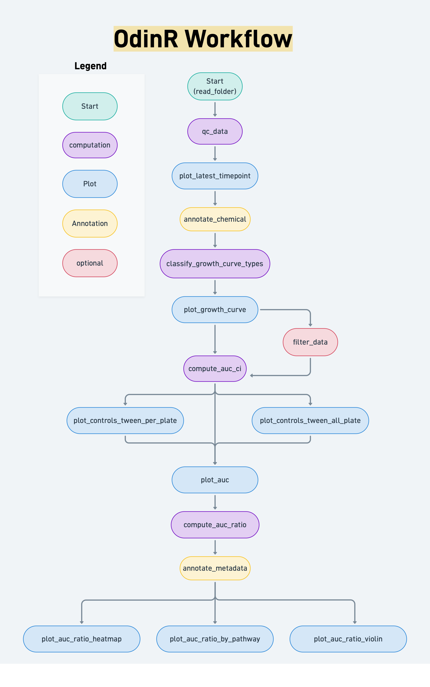

```{r, include = FALSE}
knitr::opts_chunk$set(
  collapse = TRUE,
  comment = "#>"
)
```

# Aim of this package
High-throughput metabolic phenotyping using Odin Biolog is still relatively new 
in mammalian cell culture research. As such, many questions remain:

- What do the results actually mean? i.e. is a lower or higher metabolic activity
  on anti-cancer drug plates and indicator for effectiveness of treatment ?
- Why can we observe OD drops if the dye should be irreversible ?
- How can growth dynamics be recorded and incorporated in the analysis 
  for mammalian cell cultures ?
- How do medium composition or handling affect OD readings?
- How do we handle unexpected curve shapes?

This package aims to provide:

- Simple reading of multiple `RawRead.csv` and `PlateInfo.csv` files into R.
- Noise correction: OD(590nm) – OD(740nm) (as recommended by Biolog for mammalian cells).
- Quality control plots to spot odd or problematic OD curves.
- Filtering of entire plates or specific curve types before analysis.
- Calculation of **Area Under the Curve (AUC)** as a summary metric.
- Normalization of AUC to the mean of control wells on the same plate.
- Visualizations of AUC, normalized AUC, and group-level patterns.
- Annotation of chemicals and biological metadata (e.g., KEGG pathways).
- Heatmaps and summary plots to explore biological trends.

**Important Limitations**:

- **Not suitable for bacteria or suspension cultures** — in these systems, OD(740nm) *does* reflect cell growth, so noise correction is invalid.
- **AUC does not capture curve dynamics** — two very different curves (e.g., early peak vs. slow rise) can have the same AUC.
- **Does not account for cell growth** — if your cells are growing rapidly, this may confound results.
- **Does not interpret biological meaning** — a "hit" in a metabolic module does not imply pathway activation; it only means the OD was higher or lower than controls.

#  Important to Know Before You Start

The `read_folder()` function **reads every `RawRead.csv` and `PlateInfo.csv` file** in the specified folder and all sub directories.

**Always double-check** that:

- You’ve copied only the files you want to analyze.
- There are no extra or duplicate files.
- All `PlateInfo.csv` files have the **same column order** and **same variable names**.

Also: **R is case-sensitive**.  
`H460` ≠ `h460`.  
`0Gy` ≠ `0gy`.  
This can cause missing data or errors later — so be careful!

# Workflow

```{r graphic_logo, echo = FALSE, fig.align="left", out.width='100%'}

```


## Step 1: Prepare your Data
Before you can analyze, you need to organize your files properly.

1. Create a new folder (e.g., `Odin_Analysis`).
2. Copy **all** your `RawRead.csv` and `PlateInfo.csv` files into this folder.
3. Open each `PlateInfo.csv` file in Excel or a text editor.
4. Choose **one consistent column** (e.g., `Description`, `Sample`) to store your experimental conditions.
5. Enter your experimental conditions in this format:
   `variable1_variable2_variable3`
   e.g. `H460_ctrl_2h`  
   → Use **underscores**, **no spaces**, and **consistent capitalization** to separate the variables
   Keep a **consistent** order of the variables 

Why? Because `read_folder()` splits this column into separate variables (e.g., `cell.line`, `condition`, `time.h`). If the format is inconsistent, it will fail or create duplicates.

## Step 2: Read your Data with read_folder() function

Arguments of read_folder():

- path: the location of your folder on your machine (for windows in this format "C:\Folder", for Linux "~/Folder)
- variables: the order and name of your variables in your experiment
- sample_column: the column name you stored your experiment information in (e.g H460_ctrl_2h) the PlateInfo files in Step 1

What follows next is the R code and the corresponding output.
We included example data in this package to be able to demonstrate the workflow.
Everything following a "#" in code are comments that should help understand what
the code does. 

```{r}
library(OdinR)
data("RawRead") # load example RawRead file stored in OdinR
```

If you are using RStudio an object (data frame) should now be loaded to the 
Environment tab. You can click on it's name to inspect the dataframe or type

```{r}
head(RawRead)
```

which prints the first rows of the dataframe to your console.

Let's look at the corresponding example PlateInfo.csv file.

```{r}
data("PlateInfo") # loads PlateInfo example file from OdinR
head(PlateInfo) # shows first few rows of PlateInfo dataframe
```

In this example file the column *Sample* contains the experimental information.

```{r}
head(PlateInfo$Sample) # shows first few rows of column storing experimental information
```

In the next I show an example code to load you data from a folder named "Odin" on drive A:
and assign it to an object called *data*. 

```{r}
# data <- read_folder(data_path = "A:/Odin", # folder path
#                    sample_column = "Sample", # which column in PlateInfo contains experimental information
#                    variables = c("cell.line","condition","time.h") # sets the variable names for the following workflow)
```

This function does five things:

- Read all RawRead and PlateInfo files
- annotation (i.e. joining the information) of the experimental condition from PlateInfo to RawReads
- conduct noise correction: calculate OD at 590nm - OD at 740nm and store result in column "diff_OD_590_740"
- create a list of data frames that are combined in one object with elements: *data* containing the processed RawReads and PlateInfo files, and *meta* containing the provided user information about original file path, variable names and original column name containing experimental information.

Let's load an example of multiple processed RawReads and PlateInfo files and look
at the different elements:

```{r}
data("processed_data") # load example output of read_folder() function

head(processed_data$data) # show first lines of element "data" in object "processed_data"
```
You will find that you set *variables* are now not only stored in your *sample_column*
but also separate variables. This comes in especially handy for custom analysis
and visualization. 

```{r}
processed_data$meta # display meta information: folder path, sample column, variables
```

Now that our data is read in let's check if we read in the data correctly.

## Step3: Check your data with qc_data() function
Now that the data is in, let’s **inspect it**. 

```{r,fig.width=8,fig.height=4}
qc_data(processed_data) # execute function qc_data() on read in data stored in object "processed_data" to create plot
```

This plot shows:

- **X-axis**: First 5 wells (controls).
- **Y-axis**: All combinations of your experimental variables.
- **Panels**: All distinct plate types.
- **Color**: Number of distinct OD curves per well.

**What to look for**:

- **One "Replicate" per well** → noise correction worked.
- **No missing wells** → all files were read.
- **All expected conditions** → no duplicates or missing entries.
- **No grey areas** → if a well is grey, it means no data was found.

If you see multiple replicates or grey wells, check:

- Did you miss a `RawRead.csv` or `PlateInfo.csv`?
- Is the `Sample` column formatted consistently?
- Are there spaces or typos?

## Step 4 (Optional): Visualize the Final Timepoint: plot_latest_timepoint()
To get a first overview we first visualize the latest time point (i.e. end of 
Odin read) in 96-well format. These plots should roughly represent how your
Odin plate looks like after the OD recording. In the title the specific experiment
is automatically labelled and one plot is created per distinct 96-well plate
in the read in data:

```{r, fig.width=8, fig.height=6}
plot_latest_timepoint(processed_data)
```

## Step 5: Annotate Chemicals to PlateType and Well with annotate_chemical()
To make sense of your data, you need to know **what chemical is in each well**.

The package includes built-in annotations for:

- Metabolic plates: PM-M01, PM-M02 data ("PM_M01-M02")
- Anti-cancer drug plates: PM-M11 to PM-M14 data("PM_M11_M14")

```{r}
data("PM_M01_M02") # load annotation file for PM-M01 and PM-M02
head(PM_M01_M02) # inspect for few rows
processed_data <- annotate_chemical(processed_data, annotation = PM_M01_M02) # annotate Chemical Information
head(processed_data$data)
```

Now you’ll see two new columns:

- `Chemical`: e.g., "Glucose", "Lactate", "Acetate"
- `control`: "negative" (e.g. No Chemical in well or Tween), "positive" (e.g. Glucose) or NA (all other metabolites and chemical)
                      
If you want to save your annotated data at this point, e.g. for further analysis with other
software, you can write a csv file with:

```{r}
# write.csv(processed_data$data,  # just stores the dataframe but not meta information about original file path
#          file = "A:\results")  # your file path
```

If you want to store your complete object to keep the meta information (i.e. original folder path, ...)
you can store as an .RData object that only can be read by R.
```{r}
# save(processed_data$data,
#     file = "A:\results")
```
                      
### Custom annotation files
**Want to use your own plate annotation?**  

- Create a CSV file with columns: `Plate.Type`, `Well`, `Chemical`  and `control` (should only contain "positive", "negative" or no entry). 

- Use `read_csv()` and pass it to `annotate_chemical()`.

```{r}
# install needed package
# if (!require("readr", quietly = TRUE)) {
#  install.packages("readr")
# }

# load custom annotation
# custom <- read_csv("A:/myfile.csv")
# processed_data <- annotate_chemical(processed_data, annotation = custom)
```

## Step 6: Quality control of OD curves
In real experiments, we’ve seen:

- Unexpected OD drops after an initial rise (in theory the dye provided by Odin Biolog is irreversible in physiological pH ranges).
- Wells with no increase at all.
- Flat or noisy curves.

This step helps you **identify and filter** problematic curves.

Classify_growth_curves() adds an element *classification* to the our object
*processed_data*. The classification of OD curves can be tweaked with parameters.
For details type ?classify_growth_curve_types in R or
click on the function name and press F1, which opens the help page.

```{r}
processed_data <- classify_growth_curve_types(processed_data) # classify growth curves
head(processed_data$classification)
```

The classification can visualized with the plot_growth_curve() function, that 
creates one plot per 96-well plate:

```{r,fig.width=8,fig.height=6}
plot_growth_curve(processed_data)
```

Left panel: 96-well layout with color-coded curve types.  
Right panel: Individual curves for non-growing types.

You can choose to store these plots in your "processed_data" object (for 
documentation) by assigning the results to your object. This creates a
new element in *processed_data* called *growth_curve_plots*, in which every
distinct plate is stored separately with it corresponding name compounded of 
the experimental variables and the plate type.

**Limitation**
As we only saw the before mentioned growth types OdinR is also only able to detect
these. 

```{r,fig.width=8,fig.height=6}
processed_data <- plot_growth_curve(processed_data) # store plots
processed_data$growth_curve_plots$`A_treatment_inhibitor_2h_PM-M01` # just show one plot
```

If you make the decision to omit a complete 96-well plate (e.g. due to flat_low
OD curves in the control Well, unexplainable OD drops) the function filter_data()
can remove one plate from processed_data.

Let's first recapitulate which conditions we have:

```{r,fig.width=8,fig.height=4}
# qc_plot for overview of plate types
qc_data(processed_data)
```

If we made the decision that the 96-well plate with plate type "PM-M01" in cell
line A, at treatment "treatment" and inhibitor "inhibitor" and at time point 2h
is not suited for further analysis we can omit this plate with:

```{r}
processed_data <- filter_data(processed_data,
  plate_type = "PM-M01",
  filters = list(
    cell.line = "A",
    treatment = "treatment",
    inhibitor = "inhibitor",
    time = "2h"
  )
)
```

We can re-use the qc_data function to check if we omitted the correct plate:

```{r,fig.width=8,fig.height=4}
# qc_plot for overview of plate types
qc_data(processed_data)
```

The omitted plate has now no observations (no color).

## Step 7: Summarize curves to Area under Curve (AUC)
Now that your data is clean, we can compute  the AUC for each well.
The compute_auc_ci() function may run for a couple seconds depending on the size
of your dataset and stores the results in the element *auc_results* in object
*processed_data*. 

Depending on your inspection of the curve types and after potentially omitting
complete plates from analysis you can decide which curve types to keep.
In our example data set I demonstrate how to omit the curves with OD drops (and therefore keep "growing", "flat_low" and "slow_growing"). The default setting is only to keep growing.

```{r}
processed_data <- compute_auc_ci(processed_data,
  target_curve_type = c( # keep these curve types for AUC calculation
    "growing",
    "flat_low",
    "slow_growing"
  ), 
  n_boot = 10 # low number of bootstraps for vignette
)
head(processed_data$auc_results)
```

The `AUC` column contains the area under the curve. `AUC_low` and `AUC_high` are the 95% confidence intervals (from bootstrapping).

Export for external analysis:

```{r}
# write.csv(processed_data$auc_results,file="A:\results")
```

## Step 9: Check Control Well Variability
To get an idea about the variance of control wells (and wells containing Tween)
of the same biological condition between different 96-well plates (e.g. Control wells on PM-M01 and PM-M02) 
we can employ the function plot_controls_tween_all_plate(). In case of anti-cancer-drug plates only the control wells are displayed. If you used custom annotation and labelled your control wells
as either "negative" or "positive" in the 'control' column of your custom annotation file
they will be displayed here.

```{r,fig.width=8,fig.height=8}
plot_controls_tween_all_plate(processed_data)
```

This returns a plot with:

- x-axis: AUC per Well
- y-axis: wells containing negative or positive controls
- x-axis panels: experimental conditions
- y-axis panels: experimental conditions
- symbol of points: type of control Well
- color of points: Plate Type
- dashed vertical lines: range between minimum and maximum OD of *Negative Control* or *No Chemical* over all measured wells

In the upper plot in this case we can spot that the variance between control
wells of different plates is pretty low. We can also get an idea about the variance
in the positive control of Wells containing Glucose (Glucose = red squares). In the upper
case the variance is low in the lower-left plot and high in the upper right plot.

**Look for high variability**, e.g., if `0Gy_treatment_inhibitor` shows large spread, you
may need to re-evaluate that condition.

If we want to get a first glimpse on how the AUCs of different biological conditions
compare on the same plate we can use the plot_control_tween_per_plate() function.

```{r,fig.width=8,fig.height=8}
plot_controls_tween_per_plate(processed_data,
  selected_plate = "PM-M01"
) # which Plate Type to compare
```

- x-axis: AUC per Well
- y-axis: wells containing negative or positive controls
- x-axis and y-axis panels: experimental conditions
- symbol of points: type of control Well
- dashed vertical lines: range between minimum and maximum OD of *Negative Control* or *No Chemical*

In the above plot we can e.g. see that the variance of control wells is comparably
small in all biological conditions, but that the AUCs in Wells containing Glucose
differ between conditions.

## Step 10: Compare AUCs Per Plate
After we inspected the variance of the control Wells we can proceed with visualizing
all Wells on one plate type in all biological conditions:

```{r,fig.width=10, fig.height=12}
plot_auc(processed_data,
  selected_plate = "PM-M02", # Plate Type to display
  facet_vars = c("treatment") # which two biological conditions should be compared, first variable goes on y-axis panel, second on x-axis panel
)
```

In the resulting plots the metabolites are ordered by their mean AUC across
all conditions which results in ordering from highest to lowest along the y-axis
while still preserving the ability to easily compare metabolites between conditions.

The dashed lines show the range between minimum and maximum OD of the 'negative'
control wells to preserve an indicator for data variability. In the second plot
on the left (PM-M02, ctrl) we can e.g. observe that the AUC of most wells lies
within the range of AUC wells observed in control wells.

## Step 11: Normalize AUC to AUC ratios and visualize
The above visualization does not scale for comparison between multiple experimental
conditions. One way to facilitate comparison of more conditions it to normalize the AUC to the mean
of the control wells of the respective 96-well plate. **The caveat is that we loose
the information about variability of control wells**, so decide after data inspection
if you should proceed.
We can do this with the function compute_auc_ratio(). The results are stored in
element *auc_ratio* results of *processed_data*

```{r}
processed_data <- compute_auc_ratio(processed_data)
head(processed_data$auc_ratio)
```

The AUC ratios can of course be exported for to a csv file with:
```{r}
# write.csv(processed_data$auc_ratio)
```

We can visualize the AUC ratios as a heatmap with plot_auc_ratio_heatmap().
Depending on which biological conditions you want to compare you can set the
*x_var* argument to the variable that should be displayed on the x-axis.

```{r,fig.width=10,fig.height=12}
plot_auc_ratio_heatmap(processed_data,
  plate_type = "PM-M01", # which plate type to visualize
  x_var = "treatment"  # which variable should go on x-axis, all other go in x-axis panels
) 
```

Missing values due to filtering or dropping of OD curve types will be displayed 
in grey.

In some cases, e.g. a very strong signal from Glucose making distinction of other 
Wells impossible, it might be helpful to display the AUC ratio on the log-scale. 
Please note that **this distorts your perception of results** with higher visual 
emphasis on small AUC ratios compared to natural scale.

```{r,fig.width=10,fig.height=12}
plot_auc_ratio_heatmap(processed_data,
  plate_type = "PM-M01",
  x_var = "treatment",
  scale_type = "log10" # switch from natural to log10 scale
)
```


## Step 12: Annotation of metadata
If we do not only want to visualize per plate type but leverage the fact that
metabolite or drugs on different plates might belong to one biological meaningfull
group we can annotate metadata. In case of the metabolic plates PM-M01 and PM-M02 OdinR
contains the annotation of metabolites to different hierarchies 
(module_name = pathway plus different hierarchical orders of pathways) of the KEGG database. 

```{r}
head(PM_M01_M02)
```

In case of plates PM-M11 to PM-14 it contains various information from 
'Affected Pathway' to 'Clinical Status'.

We can annotate the metadata with:
```{r}
processed_data <- annotate_metadata(processed_data, annotation = PM_M01_M02)
```

This adds additional columns to the element *auc_ratio* of *processed_data*, which
can be exported as previously shown.
In case of custom annotation you just need a data frame with one column named *Chemical*
and as many columns containing information on the Chemicals as needed.

## Step 13: Visualiation of AUC Ratios by group
We can now group our heat map by any column of the metadata that we find suitable.
In case of many distinct entries in our chosen column it might be helpful to 
only display certain entries in one specific plot. We can again choose the x-axis variable
and whether we want to display the AUC ratio on the natural or log10 scale.

```{r,fig.width=10,fig.height=10}
plot_auc_ratio_by_group(processed_data,
  group_var = "middle_hierarchy", # column in metadata
  x_var = "treatment",
  group_filter = c(
    "Nucleotide metabolism", #  which entries in 'group_var' to display
    "Amino acid metabolism"
  )
)
```

Another summary visualization are violin plots implemented in function
*plot_auc_ratio_violin()* which makes comparisons of AUC ratios of many groups at the same time
possible. In this plot we loose the information which metabolite or drug belongs to 
which point in the violin, but for detailed inspection the heat maps are available.

```{r,fig.width=10,fig.height=10}
plot_auc_ratio_violin(processed_data,
  group_var = "middle_hierarchy",
  color_var = "treatment"
) # which variable should be displayed on color scale
```

We now have the AUC ratio on the x-axis and every point represents one metabolite/drug
associated with the group on the y-axis. We can choose the variable that will be color
coded and all other experimental variables are displayed in the x-axis facets.
We can also again switch from natural to log-scale.

```{r,fig.width=10,fig.height=10}
plot_auc_ratio_violin(processed_data,
  group_var = "middle_hierarchy",
  color_var = "inhibitor", # switch color variable
  scale_type = "log10" # log 10
)
```


